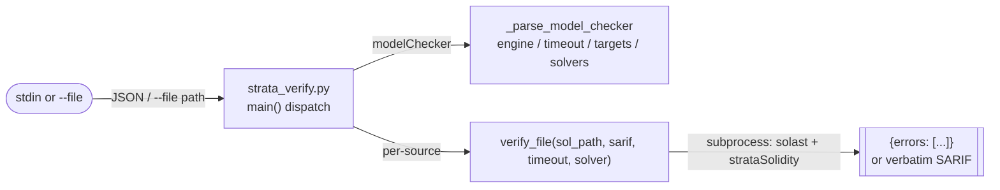

# Design Document — StrataSolidity Baseline (Retrospective)

## Introduction

This document is the **retrospective baseline design** for StrataSolidity as it exists on the current `main` branch. It describes the architecture that is actually realized in code today. It introduces no new capability, proposes no refactor, and specifies no new feature.

Every section cites the stable identifiers defined in `requirements.md` (REQ-STRATA-*, REQ-SOL-*, REQ-SPEC-*, REQ-PIPE-*, REQ-CLI-*, REQ-SH-*, REQ-PY-*, REQ-OUT-*, REQ-TEST-*, REQ-DIST-*, GAP-*, REQ-PBT-*). The companion spec `strata-solidity-next` diffs against this design; any behavior described here that is not cited by `strata-solidity-next` must be preserved unchanged.

---

## 1. Overview and Principles

### 1.1 Purpose

This design captures the existing architecture of StrataSolidity: which modules exist, how they connect, what each stage produces, and why the boundaries land where they do. It is a retrospective companion to `requirements.md` and it is descriptive, not prescriptive.

### 1.2 Principles embodied by the existing code

The architecture realizes six load-bearing principles. None of these is a proposal — each is reconstructed from the checked-in code and documentation.

1. **Specs live in NatSpec; there is no compiler fork.** StrataSolidity uses solc only as an AST oracle (`solc --ast-json`) and parses `@custom:strata` annotations in its own pipeline. `FAQ.md` records the rationale: solc is licensed GPL-3.0, so a compiler plugin would create a derivative work. NatSpec is also the standard structured-metadata mechanism in Solidity, which means existing documentation tooling continues to work (REQ-SPEC-001, REQ-SPEC-002).

2. **Python handles solc I/O only; Lean handles all semantics.** The Python layer (`solast.py`, `strata-verify.sh`, `strata_verify.py`) is a thin adapter: it drives solc, walks the solc JSON AST, and emits an Ion file. Every semantic decision — type translation, spec parsing, frame-condition generation, modifier inlining, constructor handling — lives on the Lean side in `StrataSolidity/` (REQ-STRATA-003, REQ-PIPE-001).

3. **Laurel is the target dialect, not Core or C_Simp.** Translation produces a Laurel program via `Strata.Solidity.solidityToLaurel`, which is then lowered to Core by the Strata framework's `Strata.Laurel.translate`. Laurel is chosen because it models heap-allocated objects and fields natively, which matches Solidity's storage-as-object view (REQ-STRATA-004, REQ-PIPE-007).

4. **State variables become explicit Laurel parameters; there is no heap aliasing.** Rather than relying on Laurel/Core heap parameterization for mappings and scalar state, StrataSolidity pre-flattens them. A `mapping(K=>V) m` becomes paired input/output parameters `m_in : Map[K,V]` and `m : Map[K,V]`. A scalar `uint256 s` becomes paired `__old_s`/`s`. This eliminates aliasing because Solidity storage slots are distinct by construction (REQ-SOL-090, REQ-SOL-091, FAQ "What does Solidity make easier").

5. **Frame conditions are emitted as `forall`-implication postconditions.** A clause like `modifies m[k]` generates `forall __k :: __k != k ==> select(m, __k) == select(m_in, __k)`. Unlisted state variables receive a scalar equality with their pre-state. The generation is direct; there is no separate frame-inference pass (REQ-SPEC-045, REQ-SPEC-046).

6. **Outputs are obligation-oriented with stable labels.** The CLI produces one labeled obligation per `assert` and per `ensures`. The plain-text format, `--json` array, `--sarif` results, and `--pipeline-json` `obligations[]` all key off the same `label` string, which is what downstream consumers (IDE extension, CI) match against (REQ-OUT-010..REQ-OUT-045, REQ-CLI-040).

---

## 2. System Context Diagram

### 2.1 Primary pipeline (shell-wrapper entry)

```mermaid
flowchart LR
  user([user])
  subgraph Python_layer["Python layer (Tools/Solidity)"]
    sh[strata-verify.sh]
    solast["src.solast sol_to_strata<br/>(solc --ast-json + AST walk)"]
    ion[[".solidity.st.ion<br/>(Ion bytes)"]]
  end
  subgraph Lean_binary["Lean binary: .lake/build/bin/strataSolidity"]
    read["ReadSolidity.lean<br/>Ion → Command SourceRange"]
    sol2lau["SolToLaurel<br/>Command → Laurel.Program"]
    lau2core["Strata.Laurel.translate<br/>Laurel → Core"]
    vcg["Core.verify<br/>VCG + SMT dispatch"]
    z3([z3])
  end
  output[[stdout:<br/>plain / --json / --sarif / --pipeline-json]]

  user -->|"file.sol + flags"| sh
  sh -->|"solc --ast-json | solast"| solast
  solast -->|"writes"| ion
  sh -->|"exec $STRATA_BIN ion flags"| read
  ion -->|"readBinFile"| read
  read -->|"Array (Command SourceRange)"| sol2lau
  sol2lau -->|"Laurel.Program"| lau2core
  lau2core -->|"Core.Program"| vcg
  vcg <-->|"smt2 files / unsat|sat|unknown"| z3
  vcg -->|"Array VCResult"| output
  output -->|"exit code 0|1"| user
```



### 2.2 Alternate entry: standard-JSON / file mode via Python

`Tools/Solidity/src/strata_verify.py` exposes a solc-compatible entry point. In stdin mode it reads a solc standard-JSON document with `settings.modelChecker.engine = "strata"`; in `--file` mode it runs the same two-stage pipeline for a single `.sol` path. Internally it shells out to `src.solast` and then to `.lake/build/bin/strataSolidity`, parses the stdout, and emits a `{"errors": […]}` envelope (REQ-PY-001..REQ-PY-025).



Arrow labels on both diagrams denote the artifact or invocation shape at each boundary (Solidity source text, Ion byte stream, Lean AST, Laurel program, Core program, VCResult array, text output). Nothing inside the Lean binary is exposed as a separate process; the Laurel, Core, VCG, and SMT layers are all in-process Lean calls (REQ-PIPE-001..REQ-PIPE-009).

---

## 3. Repository and Module Layout

### 3.1 Top-level tree

```
StrataSolidity/
├── lakefile.toml                   REQ-STRATA-001, REQ-TEST-001
├── lake-manifest.json              REQ-STRATA-002
├── lean-toolchain                  Requirement 1 (v4.27.0)
├── StrataSolidity.lean             public root
├── StrataSolidityMain.lean         CLI entry (REQ-CLI-*)
├── StrataSolidity/                 library sources
├── StrataSolidityTest.lean         test driver root (REQ-TEST-002)
├── StrataSolidityTest/             Lean unit + golden tests
├── Tools/Solidity/                 Python front-end + shell wrapper
│   ├── scripts/
│   │   ├── strata-verify.sh        REQ-SH-*
│   │   └── gen_dialect.sh          REQ-PY-031
│   ├── src/
│   │   ├── base_dialect.py
│   │   ├── solast.py               REQ-PIPE-001, REQ-PY-030
│   │   ├── strata_verify.py        REQ-PY-001..REQ-PY-025
│   │   └── strata_coverage.py      (used by --fail-under, REQ-PY-003)
│   └── dialects/Solidity.dialect.st.ion
├── docs/                           REQ-DIST-006, REQ-DIST-007
│   ├── ir-reference.md             source of the Laurel/Core tables in §9
│   └── guide/ (mdBook)
├── examples/                       (hand-authored demo contracts)
├── bench/                          REQ-TEST-030..REQ-TEST-036
│   └── bench.sh
├── test/                           REQ-TEST-020..REQ-TEST-024
│   └── run_tests.sh
├── scripts/                        ops helpers (notarize-release.sh, etc.)
├── CHANGELOG.md, DISTRIBUTION.md, FAQ.md, LIMITATIONS.md, README.md
└── .kiro/                          spec artefacts (this document lives here)
```

### 3.2 Lean sub-modules (`StrataSolidity/`)

| Module | Responsibility | Primary requirements |
|---|---|---|
| `SolidityDialect.lean` | Declares the Strata DDM dialect for Solidity. Defines `Strata.Solidity.Solidity` (name) and `Solidity_map`. Referenced by `Strata.Program.fromIon` inside `ReadSolidity`. | REQ-PIPE-001, REQ-PY-030 |
| `ReadSolidity.lean` | Reads an Ion file from disk and decodes it into `Array (Strata.Solidity.Command SourceRange)` via `Ion.isIonFile` and `Strata.Program.fromIon`. Public entry: `readSolidityStrata`. | REQ-PIPE-002, REQ-PIPE-006 |
| `SolTranslator/Types.lean` | Shared type aliases for the translator: `HighTypeMd`, `StmtExprMd`, `Parameter`, storage-alias and translation-error records. Defines `TransCtx` helpers that do not depend on statements. | REQ-SOL-020..REQ-SOL-034 |
| `SolTranslator/SpecParser.lean` | Tokenizer and recursive-descent parser for `@custom:strata` expression text. Produces `StmtExprMd` without resolving identifier kinds (state-var vs local). | REQ-SPEC-020..REQ-SPEC-030 |
| `SolTranslator/SpecRewriter.lean` | Post-parse rewrites: mapping identifiers → `_in`, `__old` marker resolution, scalar state-var refs in `old()` → `__old_<name>`, nested desugaring through storage aliases. | REQ-SPEC-050, REQ-SPEC-070, GAP-003 |
| `SolTranslator/ExprTranslator.lean` | Translate Solidity DDM expression nodes to Laurel `StmtExpr`. Handles identifiers, member access, index chains, binary/unary ops, casts, builtins, EVM globals. | REQ-SOL-060..REQ-SOL-079 |
| `SolTranslator/StmtTranslator.lean` | Translate Solidity statements: `if`/`while`/`for`, `return`, `require`/`assert`/`revert`, `delete`, `emit`, `unchecked`, assignments including nested mapping updates. | REQ-SOL-040..REQ-SOL-053 |
| `SolTranslator/ContractTranslator.lean` | Per-contract orchestration: iterate members, collect state vars / modifiers / constants / enums / contract invariants, lower each function (with modifier inlining and constructor specialization) to a Laurel procedure. | REQ-SOL-001..REQ-SOL-016, REQ-SPEC-060..REQ-SPEC-063 |
| `SolToLaurel.lean` | The central translation module. Aggregates helpers (`TransCtx`, `sourceRangeToMd`, `defaultValueForType`, `mkNonNegPrecond`) and provides the public entry `solidityToLaurel : Command SourceRange → Option String → Except TranslationError Laurel.Program`. | REQ-PIPE-003 |
| `Solidity.lean` | Re-export aggregator that imports `SolidityDialect`, `ReadSolidity`, and all `SolTranslator/*` modules so downstream code can `import StrataSolidity.Solidity`. | organizational |
| `SarifOutput.lean` | Build SARIF 2.1.0 JSON. Provides `StrataSolidity.Sarif.toSarif` (used by `--sarif`) and `StrataSolidity.Sarif.cleanVarName` (shared with plain-text counterexample rendering). | REQ-OUT-030, REQ-OUT-031, REQ-OUT-014 |

`StrataSolidity.lean` (at the package root) is the public face: it re-exports `SolidityDialect`, `ReadSolidity`, `Solidity`, and `SarifOutput`.

### 3.3 Python sub-modules (`Tools/Solidity/src/`)

| Module | Responsibility | Primary requirements |
|---|---|---|
| `base_dialect.py` | Shared dialect-description helpers used by `solast.py dialect` when (re)generating `Solidity.dialect.st.ion`. | REQ-PY-031 |
| `solast.py` | Canonical solc-AST-to-Ion converter. Subcommand `sol_to_strata --dialect <ion> <in.sol> <out.ion>` invokes solc, walks the JSON AST, and writes the Ion file. Subcommand `dialect <DIR>` regenerates the dialect descriptor. | REQ-PIPE-001, REQ-PY-030, REQ-PY-031 |
| `strata_verify.py` | solc-compatible wrapper. Accepts either `--file` or a standard-json document on stdin; dispatches to `verify_file`; maps output lines to a solc `errors[]` envelope. `main()` also handles `--fail-under` via `strata_coverage.analyze`. | REQ-PY-001..REQ-PY-025, REQ-PY-032 |
| `strata_coverage.py` | Coverage analyzer invoked by `_check_fail_under` in `strata_verify.py`. Returns a report with a `.score` field in `[0, 1]`; `strata_verify.py` compares `score * 100` against the `--fail-under` threshold. | REQ-PY-003 |

### 3.4 Shell and operational scripts

| Script | Responsibility | Primary requirements |
|---|---|---|
| `Tools/Solidity/scripts/strata-verify.sh` | Primary shell entry: dialect + binary prerequisite checks, `PYTHONPATH` injection, temp Ion directory, exit-code forwarding, temp-dir cleanup via `trap`. | REQ-SH-001..REQ-SH-010 |
| `Tools/Solidity/scripts/gen_dialect.sh` | Regenerate `Solidity.dialect.st.ion` (wrapper around `python3 -m src.solast dialect`). | REQ-PY-031 |
| `StrataSolidityTest/Solidity/run_sol_analyze_laurel.sh` | Primary golden harness: run `strata solAnalyzeLaurel` per test and diff normalized output against `expected/<base>.expected`; honor `known_failures.txt`. | REQ-TEST-010..REQ-TEST-016 |
| `test/run_tests.sh` | Secondary golden harness: run `$STRATA_VERIFY <file> --timeout=$TIMEOUT` and filter stdout to summary lines; auto-generates missing `expected/*.expected`. | REQ-TEST-020..REQ-TEST-024 |
| `bench/bench.sh` | Benchmark harness: run `$STRATA_VERIFY` against `bench/b*.sol`, collect `results.csv`, emit summary. | REQ-TEST-030..REQ-TEST-036 |
| `scripts/notarize-release.sh` | Package-release helper; out of scope for the verification pipeline. | — |

---

## 4. Pipeline Stages in Detail

The pipeline has five stages. Each subsection below describes one stage, identifies the module that realizes it, and cites the requirement it implements.

### 4.1 Stage 1 — Python → Ion (REQ-PIPE-001)

**Module:** `Tools/Solidity/src/solast.py`, invoked by either `strata-verify.sh` or `strata_verify.py.verify_file`.

**Contract.** The input is a path to a `.sol` file and a dialect descriptor (`Solidity.dialect.st.ion`). The output is a sibling `*.solidity.st.ion` Ion file written to a temporary directory. The invocation shape is fixed by `strata-verify.sh`:

```bash
PYTHONPATH="$PROJECT_DIR/Strata/Tools/Python:${PYTHONPATH:-}" \
  python3 -m src.solast sol_to_strata \
    --dialect "$DIALECT" "$SOL_FILE" "$ION_FILE"
```

`PYTHONPATH` is set so that `src.solast` can import Strata's Python Ion helpers from the vendored submodule (REQ-STRATA-003). `solast.py` drives solc (`solc --ast-json`), walks the JSON AST through the dialect-defined visitor, and writes the Ion payload.

**NatSpec passthrough.** The solc JSON AST carries NatSpec as a `documentation` field on functions, state variables, and contracts. `solast.py` preserves this field unchanged into the Ion stream so that `SpecParser.lean` can see the raw annotation lines downstream. No `@custom:strata` parsing happens in Python — the Python layer only moves bytes.

**Temp directory hygiene.** `strata-verify.sh` creates a `mktemp -d` directory at startup and registers `trap "rm -rf $TMPDIR" EXIT` so the Ion file is cleaned up on any exit path (REQ-SH-010). `strata_verify.py.verify_file` uses `tempfile.TemporaryDirectory()` for the same effect (REQ-PY-002).

### 4.2 Stage 2 — Ion → DDM AST (ReadSolidity, REQ-PIPE-002, REQ-PIPE-006)

**Module:** `StrataSolidity/ReadSolidity.lean`.

**Contract.** `readSolidityStrata : String → EIO String (Array (Strata.Solidity.Command SourceRange))` reads the Ion bytes via `IO.FS.readBinFile`, verifies the magic with `Ion.isIonFile`, and decodes with `Strata.Program.fromIon Strata.Solidity.Solidity_map Strata.Solidity.Solidity.name`. Every command is then lifted into the project-local `Strata.Solidity.Command` type via `Command.ofAst`. Errors are stringified and re-raised.

**SourceUnit cardinality.** `StrataSolidityMain.main` enforces exactly one top-level command of type `SourceUnit` (REQ-PIPE-006). Any other count exits with the message `Expected exactly one SourceUnit command, got <N>`. This is a hard wall; multi-file compilation is not supported at the `.solidity.st.ion` level.

**Why an Ion intermediate at all.** The Ion file is the boundary between the Python toolchain and the Lean binary. It serves two purposes: (a) it allows Lean to consume a typed DDM AST without re-implementing solc, and (b) it makes the Lean side independently runnable for golden-test replays (the Ion file is cached per test run in `run_sol_analyze_laurel.sh`).

### 4.3 Stage 3 — SolToLaurel (REQ-PIPE-003)

**Module:** `StrataSolidity/SolToLaurel.lean` plus every `StrataSolidity/SolTranslator/*.lean`.

**Public entry.**
```
Strata.Solidity.solidityToLaurel
  : Strata.Solidity.Command Strata.SourceRange
    → Option String
    → Except TranslationError Laurel.Program
```

The second argument is the path to the original `.sol` source; it becomes the `uri` embedded in every `Imperative.MetaData` record so that downstream verification results can point back at source locations.

#### 4.3.1 `TransCtx`

`TransCtx` is the per-contract translation context threaded through `ContractTranslator`, `StmtTranslator`, `ExprTranslator`, and `SpecRewriter`. It carries everything that might be needed to resolve a bare identifier. Its fields (exact set, in the order they appear in `SolToLaurel.lean`):

| Field | Purpose |
|---|---|
| `uri : Option Uri` | Source URI baked into every `sourceRangeToMd` call. |
| `structFields : List (String × List (String × HighType))` | Struct name → ordered field list; used to reorder struct constructor arguments to canonical field order. |
| `contractName : String` | Name of the enclosing contract; used when constructing constructor procedure names. |
| `contractFields : List Field` | State-variable fields of the enclosing contract, used as constructor output parameters (REQ-SPEC-062). |
| `storageAliases : List (String × StorageAlias)` | Maps a storage-reference alias (from `Voter storage sender = voters[addr];`) to its struct type and field list. Enables `sender.weight` → `Identifier "sender__weight"` field flattening. |
| `stateVarNames : List String` | Names of all state variables. Bare identifiers matching this list become `FieldSelect self "name"` unless they are mapping/array state vars (which take the explicit-parameter path). |
| `mappingStateVars : List String` | Names of mapping- and array-typed state vars. Bare identifiers for these produce `Identifier name` (the explicit parameter). |
| `arrayStateVars : List String` | Subset of `mappingStateVars` for arrays (which additionally carry a `name_length` parameter). |
| `memoryArrayParams : List String` | Memory-array function parameters that also carry a paired `_length`. |
| `nonPureFunctions : List String` | Names of non-pure functions in the contract; internal calls to these thread `self` through. |
| `localNames : List String` | In-scope locals and parameters, checked first so that locals shadow state vars. |
| `loopInvariantExprs : List StmtExprMd` | Pre-parsed loop-invariant expressions attached to the next loop encountered during function body translation. |
| `isInsideUnchecked : Bool` | True inside `unchecked { … }` blocks. No-op today because arithmetic lowers directly to `PrimitiveOp.Add/Sub/Mul` without overflow checks; the flag reserves the hook for a future bitvector encoding (REQ-SOL-048). |
| `enumDefs : List (String × List String)` | Enum name → member names; resolves `E.Member` to an integer literal (REQ-SOL-031). |
| `contractInvariantNatspec : List StmtExprMd` | Pre-parsed contract-level invariant expressions, cached so they are not re-parsed per function. |
| `modifierDefs : List (String × List (Solidity.node SourceRange))` | Modifier name → raw DDM nodes of the modifier's pre-`_;` statements. Stored raw (not translated) so they can be re-translated in each caller's context with the right state-var resolution (REQ-SOL-016). |
| `constantDefs : List (String × StmtExprMd)` | `constant` and `immutable` state-variable values, used for constant folding (REQ-SOL-034). |

#### 4.3.2 Storage-alias desugaring

A local declaration of the form `Voter storage sender = voters[addr];` is detected by `StmtTranslator.isStorageRefDecl`. `ContractTranslator` records a `StorageAlias` under the alias name with the struct's field list. Subsequent expressions that perform a member access `sender.weight` are rewritten by `ExprTranslator` into a scalar identifier `sender__weight`. In the same translation step, the storage-alias initialization is emitted as a per-field scalar assignment sequence (one per field). This is the pre-flattening strategy that avoids touching HeapParameterization for aliased structs; note that aliases through mappings still hit GAP-002 because the initializer itself cannot be translated.

#### 4.3.3 Modifier inlining

`ContractTranslator` collects every `modifier M(…) { pre; _; post; }` before lowering any function. Only the pre-`_;` statements are retained in `modifierDefs`; post-`_;` behavior is ignored. When lowering a function that applies `M(args)`, `ContractTranslator` re-translates the raw DDM nodes in the function's `TransCtx` (with the function's local bindings) and prepends them to the translated body. Pre-`_;` `require(cond)` calls are lifted into preconditions of the wrapped function (REQ-SOL-016).

#### 4.3.4 Constant folding

`constantDefs` maps `constant` and `immutable` identifiers to a pre-parsed `StmtExprMd`. `ExprTranslator` substitutes these at the identifier site, so downstream Laurel never sees the constant names (REQ-SOL-034).

#### 4.3.5 `isInsideUnchecked`

The flag is threaded through statement translation but has no semantic effect today because arithmetic is uniformly lowered to `PrimitiveOp.Add/Sub/Mul` over unbounded integers. The hook exists to allow a future bitvector encoding to key overflow checks on this flag (REQ-SOL-048).

#### 4.3.6 Enum handling

`enumDefs` gives each enum member a zero-based integer index. `translateTypeNode` detects an enum type via `ctx.enumDefs.any (·.1 == nameAnn.val)` and returns `HighType.TInt`. `ExprTranslator` resolves a member access `E.Member` where `E` is a known enum to `LiteralInt` at the member's index. No additional range constraint is currently emitted (REQ-SOL-031).

#### 4.3.7 Contract invariant caching

NatSpec on a contract with `@custom:strata invariant …` is parsed once by `SpecParser`, pre-rewritten by `SpecRewriter`, and stored in `contractInvariantNatspec`. For each function the invariant is replayed as both a precondition (with mapping references rewritten to `_in` form via `rewriteMappingIdsToIn`) and a postcondition (mapping references left in out-form). For constructors the precondition side is skipped because there is no pre-state (REQ-SPEC-060, REQ-SPEC-062).

#### 4.3.8 Source-location metadata (`sourceRangeToMd`)

```
def sourceRangeToMd (uri : Uri) (sr : SourceRange)
    : Imperative.MetaData Core.Expression
```

If the `SourceRange` is "none" (no position), returns empty metadata. Otherwise delegates to `Laurel.SourceRange.toMetaData uri sr` which packages a `FileRange` (file URI + offset range) into the Laurel metadata that eventually rides along every obligation (REQ-CLI-031).

#### 4.3.9 `defaultValueForType`

Zero-initializes a Laurel type for constructor state-var setup (REQ-SOL-092). The partial function is:

```
partial def defaultValueForType (ty : HighTypeMd) : StmtExprMd
  | .TBool        => LiteralBool false
  | .TMap _ v     => StaticCall "const" [defaultValueForType v]
  | _             => LiteralInt 0
```

Mapping defaults use `const(defaultVal(valueType))` which denotes "the map that returns the default value everywhere." This matches Solidity's semantics: every key of an unset mapping returns its type's zero.

#### 4.3.10 `mkNonNegPrecond`

Emits `Geq(Identifier paramName, LiteralInt 0)`. Applied once per unsigned integer parameter and per unsigned state variable when building the procedure specification. This is one half of the auto-assumption ladder described in §5.8; the other half (`msg.sender > 0`, `msg.value >= 0`) is injected by `ContractTranslator` (REQ-SPEC-050, REQ-SPEC-051, REQ-SPEC-052).

### 4.4 Stage 4 — Laurel → Core (REQ-PIPE-004)

**Module:** `Strata.Languages.Laurel.LaurelToCoreTranslator` inside the `Strata` submodule. StrataSolidity calls it via `Strata.Laurel.translate`. The return type is `Except Diagnostics (Core.Program × ModifiesDiagnostics)`; the `modifiesDiags` half is currently discarded in `StrataSolidityMain` but retained by the API.

**Mapping table (see §9 for the full version).** The following subset, drawn from `docs/ir-reference.md`, is what StrataSolidity relies on:

| Laurel construct | Core construct after translate |
|---|---|
| `Procedure` with `Opaque` body | `procedure … spec { … }` |
| `HighType.TInt` | `int` |
| `HighType.TBool` | `bool` |
| `HighType.TMap K V` | `Map[K, V]` (SMT `(Array K V)`) |
| `HighType.UserDefined n` | composite / abstract type |
| `StmtExpr.Forall p body` | `forall p :: body` in spec |
| `StmtExpr.Exists p body` | `exists p :: body` |
| `StmtExpr.Old e` | `old e` in `ensures` |
| `StmtExpr.FieldSelect o f` | `select(heap_f, o)` after heap parameterization |
| Object fields | flattened to map ops via HeapParameterization |

**Why we pre-flatten mapping and array state vars.** StrataSolidity bypasses HeapParameterization for mapping- and array-typed state variables by exposing them as explicit `Map[K, V]` parameters (`name_in` / `name`). This is a deliberate architectural choice: it eliminates an entire class of heap-resolution bugs for the most common Solidity spec shape (`ensures balances[a] == old(balances[a]) + amount`) and keeps the generated Core close to what z3 can actually dispatch (REQ-SOL-090).

**Why structs-through-mappings still hit HeapParameterization.** When a mapping's value type is `UserDefined "S"`, the mapping parameter is `Map[K, UserDefined S]`. A spec reference `m[k].field` is lowered to `FieldSelect (select m k) "field"`, which HeapParameterization is expected to resolve by introducing a per-field heap. Core today cannot resolve struct field names through composite mapping values, which causes GAP-002. No workaround is implemented for this shape.

### 4.5 Stage 5 — Core → SMT (REQ-PIPE-005)

**Module:** `Strata.Languages.Core.Verifier.Core.verify` inside the `Strata` submodule. Invoked with `VerifyOptions` configured by `StrataSolidityMain` (REQ-CLI-030):

```
{ VerifyOptions.default with
    stopOnFirstError := false
    verbose          := .quiet
    solver           := "z3"
    solverTimeout    := timeoutVal
    useArrayTheory   := useArrays }
```

**Obligation granularity.** Core's VCG emits one obligation per `assert` and per `ensures` clause in the flattened Core program. Each obligation carries a `label` (the spec-clause text or a generated identifier) and a `metadata` record (the `Imperative.MetaData Core.Expression` descending from `sourceRangeToMd`). The label is what appears in every output format (§8) and what `--pipeline-json` uses to locate the corresponding `.smt2` file.

**Solver dispatch.** Each obligation becomes a separate `.smt2` query. The solver is invoked once per obligation; `z3 unknown` on timeout is observable as `Outcome.unknown`. **mbqi is disabled** at the solver configuration level: enabling it causes non-termination on the universally quantified `Map` axioms (the `sum_m` update axiom and the frame-condition `forall __k`). The consequence is GAP-001: `fail` outcomes do not carry a counterexample model; they are often returned as `unknown` instead. This cascades through §8 as an empty `lexprModel` for failing results and therefore an empty counterexample block in plain and SARIF outputs (REQ-OUT-015).

---

## 5. Specification Language Design

This section describes the `@custom:strata` annotation subsystem as currently realized across `SpecParser.lean`, `SpecRewriter.lean`, and the specification-aware paths of `ContractTranslator` and `StmtTranslator`.

### 5.1 Annotation extraction (REQ-SPEC-001..REQ-SPEC-004)

`parseStrataAnnotations : String → List StrataAnnotation` scans a NatSpec documentation string line-by-line. For each line it:

1. Trims ASCII whitespace.
2. Tests for the exact prefix `@custom:strata ` (with a trailing space).
3. If matched, drops the prefix, trims again, and tests for one of five leading keywords: `requires `, `ensures `, `invariant `, `modifies `, `loop-invariant `.
4. Returns the remainder of the line as the expression text for that keyword.

Lines that do not start with `@custom:strata ` are dropped. Lines that start with the tag but use an unknown keyword (for example `@custom:strata lemma …`) are dropped silently (GAP-004).

The NatSpec `* ` prefix used inside multi-line `/** */` blocks is handled by `solast.py`'s NatSpec extraction: by the time the documentation string reaches the Lean parser, the `* ` has been stripped on each line. The acceptance criterion for `* ` handling (REQ-SPEC-002) is therefore realized at the Python/solc boundary, not inside `SpecParser.lean`.

**Documentation vs code note.** `LIMITATIONS.md` and some FAQ passages show the tag as `@strata` rather than `@custom:strata`. The parser accepts only `@custom:strata`; `@strata` is silently dropped. This is REQ-SOL-100 — a documentation defect, not a parser capability.

### 5.2 Tokenizer

`SpecParser.tokenize : String → List String` is a fuel-bounded scanner (`fuel = s.length * 4 + 10`). It recognizes:

- Single-character punctuation: `(`, `)`, `[`, `]`, `,`.
- Operator runs: `==>`, `==`, `!=`, `>=`, `<=`, `&&`, `||`, `::`.
- Single-character operators: `>`, `<`, `+`, `-`, `*`, `.`, `:`.
- Word tokens: any maximal run of non-operator, non-whitespace characters.

Whitespace is a token separator. No string-literal handling is required because `@custom:strata` expressions do not contain quoted strings.

Integer literals and identifiers are not split further at this stage; they become single word tokens that `parseAtom` classifies afterward. Scientific notation (`1e24`) flows through as a single word token and is decoded by `parseSciNotation : String → Option Nat`.

**Recognized atom forms.**

| Token shape | Recognized as |
|---|---|
| `1`, `0`, `42`, `1e24` | integer literal |
| `true`, `false` | boolean literal |
| `old` followed by `(` | old-marker keyword |
| `address` followed by `(` | identity cast |
| `msg` `.` `sender` | `Identifier "msg_sender"` |
| `msg` `.` `value` | `Identifier "msg_value"` |
| `type` `(` `Name` `)` `.` `min`/`max` | literal via `typeMinMax` |
| `forall` / `exists` followed by `v` `:` `T` `::` | quantifier |
| otherwise | identifier |

### 5.3 Precedence ladder

`parseExpr` is implemented as a stack of mutually recursive functions, each handling one precedence level. The ladder from loosest to tightest:

| Parser | Operators | Associativity |
|---|---|---|
| `parseImplies` | `==>` | right |
| `parseOr` | `\|\|` | right (right recursion) |
| `parseAnd` | `&&` | right (right recursion) |
| `parseComparison` | `==`, `!=`, `>=`, `<=`, `>`, `<` | non-assoc (one level) |
| `parseAddSub` | `+`, `-` | left (tail recursion) |
| `parseMul` | `*` | left (tail recursion) |
| `parsePostfix` | `[_]`, `(_)`, `.member` | left |
| `parseAtom` | literals, identifiers, quantifiers, keyword forms | — |

Note that `/` and `%` are not in the spec expression grammar (REQ-SPEC-028 lists them for the Solidity subset but the spec parser accepts only `+ - *`). Bitwise operators are not in the spec expression grammar at all.

### 5.4 Quantifier binding

`forall v : T :: body` and `exists v : T :: body` are parsed by `parseAtom`. The type name `T` is mapped to a Laurel `HighType` via `solTypeNameToHighType`:

| Type name | HighType |
|---|---|
| `bool` | `TBool` |
| `address` | `TInt` |
| anything else | `TInt` |

The binding is produced as a `Parameter { name := varName, type := TInt/TBool }`, and the quantifier body is recursively parsed via `parseExpr`. There is no separate identifier scope for quantifier-bound variables; they shadow outer identifiers by virtue of the subsequent `SpecRewriter` seeing the raw variable name rather than a resolved field path (REQ-SPEC-023).

### 5.5 `old(e)` handling

`parseAtom` on the keyword `old` produces a `StaticCall "__old" [inner]` marker node rather than a direct Laurel `StmtExpr.Old`. This is because identifier resolution has not yet happened at parse time — `SpecRewriter` has to walk the fully resolved expression afterward and decide whether each sub-identifier is a scalar state var (`x` → `__old_x`), a mapping (`m` → `m_in`), an array-length alias (`a_length` → `a_length_in`), or a local (no rewrite). Only after that rewrite is the `__old` wrapper stripped (for scalars) or translated to the `_in` parameter name (for mappings).

In loop invariants the rewrite is incomplete: `loopInvariantExprs` are parsed up-front and rewritten once using the enclosing function's context, but the `__old` marker is not propagated into each loop iteration's scope. This is GAP-003.

### 5.6 `sum(m)` dispatch

`parsePostfixTail` inspects a call `f(args)`. If `f == "sum"` and `args.length == 1` and the single argument is `Identifier name`, the callee is rewritten to `sum_<name>`. Downstream, `Strata.Laurel.translate` treats `sum_<name>` as a declared uninterpreted function and attaches the update axiom documented in §9 (REQ-SPEC-070).

### 5.7 Multi-arg builtin dispatch

`parsePostfixTail` also rewrites call names for the ABI-encoding family:

| Parsed callee | Rewritten to (when `args.length == 2`) |
|---|---|
| `abi_encode` | `abi_encode2` |
| `abi_encodePacked` | `abi_encodePacked2` |

These arity-tagged names correspond to the uninterpreted functions declared by the Laurel→Core translator. Only arity 2 is special-cased in the parser today; other arities pass through unchanged. `keccak256`, `sha256`, and other cryptographic builtins remain uninterpreted with a single canonical name and the standard congruence axiom (REQ-SOL-073, REQ-SOL-074).

### 5.8 `modifies` clause parsing and frame generation

`SpecParser` handles `modifies` as a comma-split list, where each clause is one of:

| Clause form | Meaning |
|---|---|
| `var` | whole-variable write |
| `m[k]` | single-key mapping write |
| `m[k1], m[k2]` | multi-key write on `m` (one entry per `m[k_i]`) |
| `a, b, c` | multi-variable list (entries in order) |

Each clause is tokenized as an expression prefix; index suffixes `[k]` are retained so that the rewriter knows which mapping key is permitted to change.

**Frame schema.** For each state variable that is *not* mentioned in `modifies`, the pipeline generates a postcondition:

- Scalar `v`: `v == __old_v`
- Mapping `m`: `m == m_in` (pointwise via Laurel's `Map` equality)
- Array `a`: `a == a_in && a_length == a_length_in`

For each mapping mentioned with key restrictions `m[k1], m[k2], …`, the pipeline emits:

```
forall __k :: __k != k1 && __k != k2 && … ==> select(m, __k) == select(m_in, __k)
```

exactly as specified by REQ-SPEC-046. The `__k` identifier is freshly chosen per clause. Whole-variable `modifies m` emits no frame obligation for `m` — the whole map is considered writable.

When `modifies` is absent entirely, no frame obligations are emitted for any state variable (REQ-SPEC-044). This makes the absence of `modifies` a deliberately unsafe default, documented in the guide.

### 5.9 Auto-assumptions

Injected as `free requires` clauses in Core (so they are assumed at the procedure body but not required of callers):

| Assumption | Trigger |
|---|---|
| `v >= 0` | any `uint*` parameter or state variable, via `mkNonNegPrecond` |
| `msg.sender > 0` | every function (zero address cannot originate a tx) |
| `msg.value >= 0` | every function |

These are realized in `ContractTranslator` during procedure construction. They are deliberately `free` so that call sites do not have to prove them (REQ-SPEC-050, REQ-SPEC-051, REQ-SPEC-052).

### 5.10 Constructor special case

For a `constructor(args) { body }`:

1. No `self` parameter is introduced (REQ-SPEC-061). The composite `self : ContractName` that regular methods take does not exist yet at construction time.
2. State variables are exposed as output parameters only; they are zero-initialized on entry using `defaultValueForType` (REQ-SOL-092, REQ-SPEC-062).
3. Contract invariants from `contractInvariantNatspec` are attached as postconditions (REQ-SPEC-060). The constructor must establish them; it does not assume them on entry.
4. `modifies self` is rejected because `self` is absent; the check is implicit in the procedure-building code path, which does not accept a `self` modifies clause for constructors.
5. References to `msg.sender` inside a constructor body produce an unsound model (GAP-006); the translation emits the reference but the Core-level semantics of constructor `msg.sender` are not established.

---

## 6. CLI Entry Point Flow (`StrataSolidityMain.lean`)

The CLI binary is a single-file driver compiled by Lake as the `strataSolidity` executable (REQ-CLI-003). This section walks the control flow from `main` downward.

### 6.1 Argument parsing

```
def main (args : List String) : IO Unit := do
  let verbose       := args.contains "--verbose"
  let sarifMode     := args.contains "--sarif"
  let jsonMode      := args.contains "--json"
  let pipelineJson  := args.contains "--pipeline-json"
  let useArrays     := args.contains "--array-theory"
  ...
```

Boolean flags are handled by `List.contains` (REQ-CLI-010..REQ-CLI-014). Value flags use a filter-then-drop pattern:

```
let dumpVcDir    := first arg matching "--dump-vc="       (drop prefix)
let solSourcePath := first arg matching "--sol-source="   (drop prefix)
let timeoutVal   := first arg matching "--timeout="        (parse .toNat?, default 10)
```

The non-flag arguments are extracted by filtering out known boolean flags and the three `--key=value` prefixes. If the result has exactly one element it is treated as the Ion file path; otherwise the binary prints the usage string to stderr and exits 1 (REQ-CLI-002).

### 6.2 `readSolidityStrata'`

```
private def readSolidityStrata' (strataPath : String)
    : IO (Array (Strata.Solidity.Command SourceRange))
```

Wraps `Strata.Solidity.readSolidityStrata` and converts any IO error to `exitFailure`, which prints `Exception: {message}` to stderr and calls `IO.Process.exit 1`. This means the stage-2 failure mode is uniform: any unreadable Ion file results in a non-zero exit with a stderr diagnostic, matching REQ-PIPE-002 and REQ-PIPE-006.

### 6.3 `ionPathToSolidityPath` and `tryReadSoliditySource`

```
private def ionPathToSolidityPath (ionPath : String) : Option String
  := if ionPath.endsWith ".solidity.st.ion"
       then some (ionPath.dropEnd … ++ ".sol") else none

private def tryReadSoliditySource (ionPath : String)
    : IO (Option (String × String))
```

`tryReadSoliditySource` first derives a sibling `.sol` path from the Ion path; if the derivation succeeds it attempts `IO.FS.readFile` and returns `(srcPath, content)` on success or `none` on any failure. The result is fed into `resolvePosition` for source-location reconstruction (REQ-CLI-031). If the user provides `--sol-source=PATH` explicitly, that path is tried first; on read failure the binary falls back to the auto-derived path (REQ-CLI-032, REQ-CLI-033).

### 6.4 `resolvePosition`

```
private def resolvePosition (vcr : VCResult)
    (sourceOpt : Option (String × String)) : Option (Nat × Nat)
```

Logic:

1. Extract `Imperative.getFileRange vcr.obligation.metadata`. If none, return `none`.
2. If the range is "none" (zero width), return `none`.
3. Match `sourceOpt`: if it is `some (srcPath, srcText)` and the `FileRange.file` matches `srcPath`, build a `Lean.FileMap.ofString srcText`, call `toPosition fr.range.start`, and return `(line, column)`.
4. Any mismatch returns `none`.

This is the only place (line, col) tuples are computed. All four output modes (plain, `--json`, `--sarif`, `--pipeline-json`) re-use this function, so a change to source-range semantics in Laurel has a single point of impact in StrataSolidity.

### 6.5 SMT directory selection

`Core.verify` is invoked inside one of three branches, selected in this precedence order:

| Branch | Condition | Directory |
|---|---|---|
| explicit dump | `--dump-vc=DIR` | `DIR` (created if missing) |
| fixed dir | `STRATA_SMT_DIR` set **or** `--pipeline-json` | env value, else `/tmp/strata-pipeline-smt` |
| ephemeral | none of the above | `IO.FS.withTempDir` scope |

For the fixed-dir branch, pre-cleanup removes any existing `*.smt2` entries before the call so that `--pipeline-json`'s post-hoc SMT lookup only sees files from the current run (REQ-CLI-023). `IO.FS.readDir` and `IO.FS.removeFile` are wrapped in `.catchExceptions` so missing-directory and permission edge cases do not crash the binary.

The ephemeral branch uses `IO.FS.withTempDir`, which guarantees cleanup on all exit paths. This is the path taken by the default CI configuration (REQ-CLI-021).

### 6.6 Output-mode precedence

After `Core.verify` returns `vcResults : Array VCResult`, the binary selects exactly one output format in this order (REQ-CLI-040):

1. `pipelineJson` → build `laurel`, `core`, `obligations[]`, `summary` JSON and print.
2. `sarifMode` → call `StrataSolidity.Sarif.toSarif vcResults solSourceOpt` and print.
3. `jsonMode` → call `formatJsonResults vcResults solSourceOpt` and print.
4. fall through → call `formatVcResultsWithLocation` and print the plain-text report.

`--verbose` output (`==== Solidity AST (Ion) loaded ====`, `==== Laurel Program ====`, `==== Core Program ====`) is printed earlier, before verification, and is orthogonal to the output mode (REQ-CLI-060..REQ-CLI-062).

### 6.7 `formatVcResultsWithLocation`

Groups results into `Failures`, `Unknown`, `Passed` sections in that order (REQ-OUT-011). For each failing or implementation-error result it calls `formatPlainCounterexample` on `vcr.lexprModel`, which produces the 8-space-indented `<varName> = <value>` lines (REQ-OUT-014). `cleanVarName` from `SarifOutput.lean` is shared here so the plain and SARIF counterexample variable names agree.

The return value is `(String × Bool)` where the Bool is `hasFailures`; the caller uses it to set the exit code (see §6.9). The final summary line `N passed, M failed, K unknown out of T total` matches REQ-OUT-013 exactly.

### 6.8 `formatJsonResults`

Emits a JSON array. Each element is always `{"name": <label>, "status": <label>}`; if `resolvePosition` returns `some (line, col)` it is augmented with `"line": N, "col": N`. This realizes REQ-OUT-020..REQ-OUT-023.

Note: `--json` status strings use the `statusLabel` helper which maps `Outcome.implementationError _` to the literal `"implementation_error"`, matching REQ-PBT-005.

### 6.9 Exit-code contract

Plain-text mode: `hasFailures = nFail > 0` where `nFail` counts both `Outcome.fail` and `Outcome.implementationError`. On `hasFailures` the binary calls `IO.Process.exit 1` (REQ-CLI-050). Otherwise it falls through `main` and exits 0 (REQ-CLI-051).

All other output modes (`--json`, `--sarif`, `--pipeline-json`) return from `main` after printing. They do **not** set the exit code based on `VCResult` outcomes. This is a deliberate asymmetry: IDE and CI integrations consuming structured output parse the payload and decide for themselves. Plain-text mode is the only "humans + scripts via exit code" interface.

`Outcome.unknown` never sets a failing exit code (REQ-CLI-052). This is driven by GAP-001 — counterexample generation is disabled, so the binary cannot distinguish "genuinely unknown" from "bug with no model." Treating unknown as failing would break CI on every run. The cost is that GAP-001-driven flakiness is silent in CI until counterexamples are turned on.

---

## 7. Python Tooling Design

The Python layer is small by design: one shell wrapper for the common case, one solc-compatible wrapper for integration with standard tooling, and two helpers (`solast.py`, `strata_coverage.py`).

### 7.1 `strata-verify.sh`

Responsibilities, in order of execution:

1. **Usage check.** If fewer than one argument is supplied, print `Usage: strata-verify <file.sol> [--sarif] [--verbose]` to stderr and exit 1 (REQ-SH-002).
2. **Input check.** Absolute-path-normalize `$1`; if it does not exist, print `Error: <path> not found` and exit 1 (REQ-SH-003).
3. **Dialect check.** If `Tools/Solidity/dialects/Solidity.dialect.st.ion` is missing, print `Error: Dialect not found at <path>. Run gen_dialect.sh first.` and exit 1 (REQ-SH-004).
4. **Binary check.** If `.lake/build/bin/strataSolidity` is missing, print `Error: strataSolidity not built. Run 'lake build' in <project> first.` and exit 1 (REQ-SH-005).
5. **Temp dir.** `TMPDIR=$(mktemp -d)` then `trap "rm -rf $TMPDIR" EXIT` (REQ-SH-010).
6. **`PYTHONPATH` injection.** `PYTHONPATH="${STRATA_PYTHON}:${PYTHONPATH:-}"` where `STRATA_PYTHON="$PROJECT_DIR/Strata/Tools/Python"` (REQ-STRATA-003, REQ-SH-007).
7. **Stage-1 invocation.** `cd "$TOOLS_DIR" && python3 -m src.solast sol_to_strata --dialect "$DIALECT" "$SOL_FILE" "$ION_FILE"`. On failure: print `Error: Failed to parse $SOL_FILE` and exit non-zero (REQ-SH-008).
8. **Stage-2 invocation.** `"$STRATA_BIN" "$ION_FILE" $EXTRA_ARGS`. The script uses `set -euo pipefail`, so the Lean binary's non-zero exit code propagates to the script's exit code (REQ-SH-009).

The script never filters stdout or stderr; the Lean binary's output reaches the terminal unmodified. This is important for CI runners that grep for the plain-text summary line (REQ-TEST-022).

### 7.2 `strata_verify.py` structure

```
def verify_file(sol_path: str, sarif: bool = False,
                timeout: int = 0, solver: str = "z3") -> dict
def _parse_model_checker(mc: dict) -> dict
def main()
def _check_fail_under(sol_path: str, threshold: float)
```

#### 7.2.1 `verify_file`

Core pipeline function:

1. Create `tempfile.TemporaryDirectory`; derive `ion_path = <tmp>/<stem>.solidity.st.ion`.
2. Build an `env` dict with the same `PYTHONPATH` injection as `strata-verify.sh`.
3. Run `solast.py sol_to_strata` via `subprocess.run(..., check=True, capture_output=True, text=True)`. On `CalledProcessError` return `{"errors": [{"severity": "error", "message": f"Parse failed: {e.stderr}"}]}` (REQ-PY-025).
4. Build `cmd = [STRATA_BIN, ion_path]` and append `--sarif` if requested.
5. Run the Lean binary via `subprocess.run(..., timeout=timeout if timeout > 0 else None)`. On `TimeoutExpired` return `{"errors": [{"severity": "warning", "message": "Verification timed out"}]}` (REQ-PY-023).
6. If `returncode != 0 and not stdout`, return `{"errors": [{"severity": "error", "message": result.stderr.strip()}]}` (REQ-PY-024).
7. **SARIF path.** If `sarif=True` and stdout is non-empty, `return json.loads(result.stdout)`. The SARIF payload is passed through verbatim (REQ-PY-004).
8. **Plain path.** Iterate stdout lines, strip, skip empty and `====`-header lines, and classify each remaining line:

   | Substring | Mapped to |
   |---|---|
   | `✅ pass` | `{severity: "warning", type: "Info", message: "Strata: <line>"}` |
   | `❌ fail` | `{severity: "error", message: "Strata: <line>"}` |
   | `🟡 unknown` | `{severity: "warning", message: "Strata: <line>"}` |

   The specification text in REQ-PY-022 references `🟡 unknown`; the plain-text emitter in `StrataSolidityMain` uses `❓` in headers and omits a per-line emoji for unknown entries. That historical mismatch means the plain parser in `strata_verify.py` treats `unknown` entries as warnings without an emoji match in practice; this inconsistency is preserved unchanged in the baseline.

#### 7.2.2 `_parse_model_checker`

Normalizes `settings.modelChecker` from a solc standard-JSON document:

| Input field | Behavior |
|---|---|
| `engine` | copied through; default `"strata"` |
| `timeout` | copied through; default `0` (meaning no timeout at the Python layer) |
| `targets` | copied into `cfg["targets"]` for passthrough into the output envelope |
| `contracts` | copied but `logger.warning` emitted (REQ-PY-015) |
| `solvers` | first entry used; `warning` emitted if not `z3`; solver is forced to `z3` regardless (GAP-012, REQ-PY-016) |

`cfg["_solver"]` holds the resolved solver name for later use; the leading underscore marks it as internal to the function.

#### 7.2.3 `main()`

Dispatch logic:

1. Handle `--fail-under N` by splicing the two arguments out of `sys.argv` and storing `fail_under` as a float (REQ-PY-003).
2. If `--file` is in `sys.argv`: read the path immediately following, read `sarif = "--sarif" in sys.argv`, call `verify_file`, `print(json.dumps(result, indent=2))`, and if `fail_under is not None` call `_check_fail_under`. Return.
3. Otherwise read standard-JSON from stdin via `json.load(sys.stdin)`. On `JSONDecodeError` emit the exact invalid-input envelope from REQ-PY-011 and return.
4. Validate `settings.modelChecker.engine == "strata"`; otherwise emit the unsupported-engine envelope (REQ-PY-012).
5. Call `_parse_model_checker` to normalize settings.
6. For each `filename, source_info` in `input_json["sources"]`: write the content to a per-source path under `tempdir`, run `verify_file`, accumulate the `errors` into `all_errors`.
7. Build the output: `{"errors": all_errors}`, plus `modelCheckerTargets` if it was present in the input (REQ-PY-014). `print(json.dumps(output, indent=2))`.

#### 7.2.4 `_check_fail_under`

```
from src.strata_coverage import analyze
report = analyze(sol_path)
pct = report.score * 100
if pct < threshold: print "FAIL" to stderr and sys.exit(1)
else:               print "OK" to stderr
```

`strata_coverage.analyze(sol_path)` is the sole coverage contract; StrataSolidity does not re-implement coverage in the Lean layer (REQ-PY-003).

### 7.3 Output envelope construction

The output-envelope shape is fixed to `{"errors": [ … ]}` for both modes (REQ-PY-020). Entries always have `severity`, optionally `type`, always `message` (REQ-PY-021). When `modelCheckerTargets` was set in the input, it is echoed into the top level; no other pass-through of standard-JSON fields is performed. The envelope is printed with `indent=2` for human readability — downstream parsers in CI treat it as JSON and ignore the formatting.

---

## 8. Outputs

This section describes each output format as produced by the binary.

### 8.1 Plain text (REQ-OUT-010..REQ-OUT-015)

Exact structure:

```
==== Verification Results ====

❌ Failures (<nFail>):
  <label1>[ at line <L>, col <C>]
        <var1> = <val1>
        <var2> = <val2>
  <label2>[ at line <L>, col <C>]

❓ Unknown (<nUnknown>):
  <label3>[ at line <L>, col <C>]

✅ Passed (<nPass>):
  <label4>[ at line <L>, col <C>]

<nPass> passed, <nFail> failed, <nUnknown> unknown out of <N> total
```

Headers are emitted only for non-empty sections. `hasFailures` is true iff `nFail > 0`, which drives the exit-code branch at §6.9.

Counterexample lines are produced by `formatPlainCounterexample`: each entry in `vcr.lexprModel` is indented exactly 8 spaces, rendered as `<name> = <value>`, with `name` passed through `StrataSolidity.Sarif.cleanVarName`. The `cleanVarName` rules (stripping `self.`, `_param`, `_in` suffixes; replacing `__` with `.`) mean counterexample output is reader-friendly even though the Core-level identifiers carry bookkeeping suffixes. Under today's solver configuration (mbqi disabled, GAP-001) `lexprModel` is almost always empty for failing results, so this block is usually absent in practice (REQ-OUT-015).

### 8.2 `--json` (REQ-OUT-020..REQ-OUT-023)

`formatJsonResults` produces `Json.arr` from the result array. Element fields:

| Field | Always present? | Type |
|---|---|---|
| `name` | yes | string (obligation label) |
| `status` | yes | one of `"pass"`, `"fail"`, `"unknown"`, `"implementation_error"` |
| `line` | only if `resolvePosition` returned some | integer |
| `col` | only if `resolvePosition` returned some | integer |

The `Json.pretty` call at the end formats with Lean's default indentation. Consumers should not depend on exact whitespace but the field names and the element order (as returned by `Core.verify`) are stable (REQ-PBT-005).

### 8.3 `--sarif` (REQ-OUT-030, REQ-OUT-031)

`StrataSolidity.Sarif.toSarif : Array VCResult → Option (String × String) → Json` builds the SARIF 2.1.0 top-level object. Relevant helpers:

| Helper | Role |
|---|---|
| `cleanVarName` | strips `self.`, `_param`, `_in` suffixes and replaces `__` with `.`; shared with plain-text counterexample rendering. |
| `mkRule id desc` | builds a SARIF `reportingDescriptor` element. |
| `ruleDefinitions` | fixed array of five rules: `strata/ensures-fail`, `strata/requires-fail`, `strata/invariant-fail`, `strata/assert-fail`, `strata/unknown`. |
| `classifyRule label` | string match on the obligation label (`ensures` → index 0, `requires` → 1, `invariant` → 2, `assert` → 3, else 4). |
| `simpleHash` | deterministic 31-multiplier hash for SARIF `fingerprints`. |
| `resultLevel` / `resultKind` / `resultMessage` | map `Outcome` to SARIF fields. |
| `vcResultToJson` | build one `results[]` entry; uses `sourceOpt` to populate `locations` only when `resolvePosition`-equivalent logic resolves a file URI. |

The binary sets `driver.name` to `strataSolidity` and hoists `ruleDefinitions` into `run.tool.driver.rules`. This is the full SARIF 2.1.0 shape; REQ-PBT-004 pins schema compliance as a preservation property.

### 8.4 `--pipeline-json` (REQ-OUT-040..REQ-OUT-045)

Built inline in `StrataSolidityMain.main`. Top-level structure:

```
{
  "laurel":      <rendered Laurel program as a string>,
  "core":        <rendered Core program as a string>,
  "obligations": [
    { "label": <string>,
      "status": "pass" | "fail" | "unknown",
      "smt":    <string>,
      "smtResult": "unsat" | "sat" | "unknown" }, ...
  ],
  "summary": {
    "total":   <int>,
    "passed":  <int>,
    "failed":  <int>,
    "unknown": <int>
  }
}
```

**Best-effort SMT file lookup.** For each `VCResult` the binary lists the fixed SMT directory (§6.5), filters entries whose filename contains the obligation label as a substring and ends with `.smt2`, and reads the first match. On any I/O error the `smt` field is `""` rather than failing the whole call (REQ-OUT-045). The filename-substring match is best-effort because label-to-filename sanitization inside Core is not fully injective; collisions have not been observed in practice but the design accepts that a collision would show the wrong SMT file.

**`smtResult` derivation.** The field is derived from the `VCResult` outcome, not by parsing the SMT file:

| VCResult | smtResult |
|---|---|
| `Outcome.pass` | `"unsat"` |
| `Outcome.fail` | `"sat"` |
| `Outcome.unknown` or `Outcome.implementationError _` | `"unknown"` |

This is deliberately denormalized so that downstream consumers do not have to re-run z3.

---


## 9. Laurel Mapping Tables

This section is the canonical mapping between the Solidity constructs accepted today and the Laurel IR emitted by `SolToLaurel`. It extends the high-level tables in `docs/ir-reference.md` with the specific lowering rules used by `SolTranslator/*`. It realizes REQ-PIPE-003 and REQ-PIPE-007.

### 9.1 State variable lowering

| Solidity declaration | Laurel input parameters | Laurel output parameters | Notes |
|---|---|---|---|
| `uint256 totalSupply` | `__old_totalSupply : int` | `totalSupply : int` | Scalar. `__old_<name>` is the pre-state. (REQ-SOL-091) |
| `bool paused` | `__old_paused : bool` | `paused : bool` | Same scheme for booleans. |
| `address owner` | `__old_owner : int` | `owner : int` | `address` lowered to `int` (REQ-SOL-022). |
| `mapping(address => uint256) balances` | `balances_in : Map[int, int]` | `balances : Map[int, int]` | Pre-flattened (REQ-SOL-090). |
| `mapping(address => mapping(address => uint256)) allowance` | `allowance_in : Map[int, Map[int, int]]` | `allowance : Map[int, Map[int, int]]` | Nested mapping stays nested; nested `select`/`update` handled by `buildNestedUpdate`. |
| `uint256[] queue` (dynamic array) | `queue_in : Map[int, int]`, `queue_length_in : int` | `queue : Map[int, int]`, `queue_length : int` | Length tracked as a paired scalar (REQ-SOL-027, REQ-SOL-028). |
| `uint256[10] fixed` | `fixed_in : Map[int, int]` | `fixed : Map[int, int]` | Fixed-size; no length parameter. |
| `struct S { ... } S[] list` | treated as UserDefined (opaque) through heap parameterization | same | Struct-in-mapping cases covered by GAP-002. |
| `uint256 immutable rate` | constant-folded at translation time | no output entry | `constantDefs` in `TransCtx` (REQ-SOL-034). |
| `uint256 constant MAX = 100` | constant-folded at translation time | no output entry | Same path as `immutable`. |
| `uint256 transient tmp` | `__old_tmp : int` | `tmp : int` | Within-transaction semantics only (REQ-SOL-035, Non-goal 4). |

Every uint-typed input parameter additionally receives a `free requires` of `v >= 0` (REQ-SPEC-050), emitted via `mkNonNegPrecond`.

### 9.2 Statement lowering

| Solidity | Laurel `StmtExpr` | Requirement |
|---|---|---|
| `if (c) a else b` | `IfThenElse c a b?` | REQ-SOL-040 |
| `while (c) body` | `While c <loopInvariantExprs> none body` | REQ-SOL-041, REQ-SPEC-005 via `loopInvariantExprs` |
| `for (init; c; step) body` | desugared to `{ init; while (c) { body; step } }` | REQ-SOL-042 |
| `return e` | `Return (some e)` | REQ-SOL-043 |
| `return` | `Return none` | REQ-SOL-043 |
| `require(c)` | `Assume c` | REQ-SOL-044 |
| `require(c, msg)` | `Assume c` (message dropped) | REQ-SOL-044 |
| `require(c, E(args))` | `Assume c` (custom error dropped) | REQ-SOL-044 |
| `assert(c)` | `Assert c` (labeled `assert`) | REQ-SOL-045 |
| `revert()` / `revert("msg")` | `Assume false` | REQ-SOL-046, REQ-SOL-047 |
| `revert E(args)` | `Assume false` | REQ-SOL-046 |
| `delete x` | `Assign [x] (defaultValueForType T_x)` | REQ-SOL-049 |
| `emit Event(args)` | `Block []` (no-op) | REQ-SOL-050, REQ-SPEC-053 |
| `unchecked { body }` | enters body with `isInsideUnchecked := true`; arithmetic lowering unchanged today | REQ-SOL-048 |
| `try C.f(args) { ok } catch { err }` | `Block []` (skipped; sound overapproximation) | REQ-SOL-051 |
| `(a, b) = expr` (tuple destructuring, >1 component) | sound overapproximation (havoc of LHS names) | REQ-SOL-052 |
| `assembly { ... }` | havoc touched state variables | REQ-SOL-053 |
| `x = e` | `Assign [x] e`; mapping LHS uses `buildNestedUpdate` | REQ-SOL-065, REQ-SOL-066 |
| `x[k1][k2] = e` | `Assign [x] (update(x, k1, update(select(x, k1), k2, e)))` | `buildNestedUpdate` |
| `self.f` on a scalar state var | `FieldSelect self "f"` | REQ-SOL-091 |
| `f()` internal call into non-pure function | `StaticCall f' (threaded-self args)` | `nonPureFunctions` in `TransCtx` |

Array-index bounds checks are emitted as preceding `Assert (idx >= 0)` statements collected by `collectArrayIndexNodesStmt`, not as expression wrappers, to keep side-effectful indices single-evaluation.

### 9.3 Expression lowering

| Solidity | Laurel | Requirement |
|---|---|---|
| Integer literal `123` | `LiteralInt 123` | REQ-SPEC-020 |
| Scientific literal `1e24` | `LiteralInt (10^24)` | REQ-SPEC-020 |
| `true` / `false` | `LiteralBool …` | REQ-SPEC-020 |
| Identifier (local) | `Identifier name` | — |
| Identifier (scalar state var) | `FieldSelect self name` | REQ-SOL-091 |
| Identifier (mapping state var) | `Identifier name` | REQ-SOL-090 |
| `msg.sender` | `Identifier "msg_sender"` | REQ-SPEC-027 |
| `msg.value` | `Identifier "msg_value"` | REQ-SPEC-027 |
| `address(0)` / `address(e)` | identity on inner expression | REQ-SPEC-027, REQ-SOL-068 |
| `type(uint256).max` | `LiteralInt (2^256 - 1)` | REQ-SPEC-025 |
| `type(int256).min` | `LiteralInt (-(2^255))` | REQ-SPEC-025 |
| `a + b`, `-`, `*`, `/`, `%` | `PrimitiveOp .Add [a, b]` etc. | REQ-SOL-060 |
| `a == b`, `!=`, `<`, `<=`, `>`, `>=` | `PrimitiveOp .Eq [a, b]` etc. | REQ-SOL-061 |
| `a && b`, `\|\|`, `!a` | `PrimitiveOp .And/.Or/.Not` | REQ-SOL-062 |
| `a ==> b` (spec only) | `PrimitiveOp .Implies [a, b]` | REQ-SPEC-024 |
| `a & b`, `\|`, `^`, `~`, `<<`, `>>` | `StaticCall "bitand" [a, b]` etc. (uninterpreted) | REQ-SOL-063 |
| `c ? a : b` | `IfThenElse c a (some b)` | REQ-SOL-064 |
| `m[k]` (mapping/array read) | `StaticCall "select" [m, k]` | REQ-SOL-065 |
| `obj.field` | `FieldSelect obj "field"` | REQ-SOL-066 |
| `x.length` (array) | `Identifier "<x>_length"` | REQ-SOL-028 |
| `keccak256(x)` | `StaticCall "keccak256" [x]` | REQ-SOL-073 |
| `keccak256(abi.encodePacked(a, b))` | `StaticCall "keccak256" [StaticCall "abi_encodePacked2" [a, b]]` | REQ-SOL-073, REQ-SOL-074 |
| `abi.encode(a, b)` (2 args) | `StaticCall "abi_encode2" [a, b]` | REQ-SOL-073 |
| `sum(balances)` | `StaticCall "sum_balances" [balances]` plus update axiom | REQ-SPEC-022, REQ-SPEC-070 |
| `old(e)` (spec only) | `StaticCall "__old" [e]` marker; rewritten by `SpecRewriter` | REQ-SPEC-021 |
| `forall v : T :: body` | `Forall ⟨v, highTypeOf T⟩ body` | REQ-SPEC-023 |
| `exists v : T :: body` | `Exists ⟨v, highTypeOf T⟩ body` | REQ-SPEC-023 |
| `call / delegatecall / staticcall` | nondeterministic: `(bool ok, bytes memory data)` havoced | REQ-SOL-076, GAP-007 |
| `new C(args)` | nondeterministic address returned | REQ-SOL-077, GAP-007 |

### 9.4 Frame-condition schema

For a `@custom:strata modifies ...` clause, the generator emits the following Laurel postconditions (the pattern is identical for every function that has a `modifies` clause; REQ-SPEC-045, REQ-SPEC-046):

**Whole mapping listed** — `modifies balances` — no constraint emitted on `balances`; every other state variable gets the equality rule below.

**Key-scoped mapping listed** — `modifies balances[k1], balances[k2]`:

```
Forall(__k : int,
  PrimitiveOp .Implies [
    PrimitiveOp .And [
      PrimitiveOp .Neq [Identifier "__k", k1],
      PrimitiveOp .Neq [Identifier "__k", k2]
    ],
    PrimitiveOp .Eq [
      StaticCall "select" [Identifier "balances", Identifier "__k"],
      StaticCall "select" [Identifier "balances_in", Identifier "__k"]
    ]
  ])
```

**Unlisted scalar state variable `s`** — postcondition `s == __old_s`.

**Unlisted mapping state variable `m`** — postcondition `forall __k :: select(m, __k) == select(m_in, __k)`.

### 9.5 `sum()` update axiom

For every mapping `m : Map[int, int]` referenced by a `sum(m)` expression, the pipeline declares an uninterpreted function `sum_m : Map[int, int] → int` and emits the update axiom (REQ-SPEC-070):

```
forall m : Map[int, int], k : int, v : int ::
  sum_m(update(m, k, v)) == sum_m(m) - select(m, k) + v
```

This axiom pattern, combined with the frame conditions, is what lets `totalSupply == sum(balances)` invariants survive ERC-20 style writes.

### 9.6 `old()` marker resolution

`SpecParser` emits `old(e)` as `StaticCall "__old" [e]`. `SpecRewriter` walks the AST after name resolution has been established by `ContractTranslator` and replaces each marker as follows:

| Argument shape | Rewrite |
|---|---|
| `Identifier name` where `name ∈ mappingStateVars` | `Identifier "<name>_in"` |
| `Identifier name` where `name ∈ stateVarNames` (scalar) | `Identifier "__old_<name>"` |
| `StaticCall "select" [m, k]` with `m` a mapping state var | `StaticCall "select" [Identifier "<m>_in", k]` |
| Nested / composite expressions | recurse into subterms |

Loop bodies do not participate in this rewrite because the loop-invariant rewriter runs on a narrower scope that does not receive the same pre-state mapping; this is the architectural cause of GAP-003.

---

## 10. Test Architecture

This section documents the three harnesses that exist today (Lean unit tests, two golden-file runners, and a benchmark runner) and how they pin observable behavior. It realizes REQ-TEST-001..REQ-TEST-036.

### 10.1 Lean unit tests

| Module | Scope |
|---|---|
| `StrataSolidityTest.Solidity.TypesTest` | Unit tests for `SolType`, `translateTypeName`, `translateTypeNode`, `defaultValueForType`, and uint-bounds helpers from `SolTranslator/Types.lean`. |
| `StrataSolidityTest.Solidity.SpecParserTest` | Tokenizer and parser round-trip tests for every annotation keyword, quantifier forms, `old()`, `sum()`, `type(T).min/max`, scientific-notation literals, precedence ladder. |
| `StrataSolidityTest.Solidity.SpecRewriterTest` | Rewriter fixtures for `__old` marker resolution, mapping-identifier to `_in` substitution, and scalar state-var `old()` → `__old_<name>`. |

All three are re-exported from `StrataSolidityTest.lean` and exposed to Lake as `testDriver = "StrataSolidityTest"` (REQ-TEST-001..REQ-TEST-003). `lake test` is the single entry point.

### 10.2 Primary golden harness — `StrataSolidityTest/Solidity/run_sol_analyze_laurel.sh`

The primary harness exercises the translation pipeline end-to-end and compares normalized stdout to a committed `expected/<base>.expected` file (REQ-TEST-010..REQ-TEST-016). Two features deserve explicit documentation because they affect reproducibility.

**Binary under test.** The harness currently invokes the root Strata binary `strata solAnalyzeLaurel`, not the `strataSolidity` CLI. This is historical: the harness predates the standalone CLI and exercises the Laurel-only end of the translator. Rewriting the harness to call `strataSolidity` is tracked implicitly through REQ-TEST-010 (not GAP-scoped).

**Normalization pipeline.** Raw output from the Lean binary contains volatile strings (Lake build paths, internal backtraces, identity numbers, panics on shape errors). The harness strips them before diff:

| Step | Pattern | Reason |
|---|---|---|
| Remove backtraces | `/^(backtrace|thread .*? panicked)/d` | Lean panics include non-deterministic pointers. |
| Remove Lake paths | `/\.lake\//d` | Absolute paths vary between machines. |
| Collapse blank runs | `sed '/^\s*$/N;/^\s*\n\s*$/D'` | Keep consecutive blanks from inflating diffs. |
| Module position mask | `s/(Module:)[0-9]+:[0-9]+/\1*:*/g` | Source positions drift with edits. |
| Unique-id mask | `s/uniqueId := some [0-9]+/uniqueId := some <id>/g` | Interpreter allocation order is not stable. |
| AST dump strip | `awk` block to delete everything after `PANIC ... getType called on` | The multi-line AST dump is a mis-shaped node signal, not behavior under test. |

**XFAIL registry.** `known_failures.txt` is read line-by-line, skipping blank lines and `#` comments. Tests listed there are classified `XFAIL` when they fail and `XPASS` when they unexpectedly pass. Any `XPASS` is an error (REQ-TEST-013). As of this baseline the registry contains exactly `test_interface_abstract` and `test_new_expression` (REQ-TEST-016, GAP-011).

**Exit policy.** The harness exits `1` if any `FAIL` or `XPASS` occurred, or if zero tests actually ran (REQ-TEST-014, REQ-TEST-015).

### 10.3 Secondary golden harness — `test/run_tests.sh`

A smaller harness that exercises `strata-verify.sh` end-to-end rather than the raw Laurel analyzer. It iterates `test/examples/*.sol`, runs `$STRATA_VERIFY <file> --timeout=$TIMEOUT`, and filters stdout through `grep -E "Passed|Failed|Unknown|total|passed" | grep -v "PANIC|backtrace"` to isolate the stable summary lines (REQ-TEST-020..REQ-TEST-024). Missing `.expected` files are auto-generated on first run; the caller is responsible for reviewing and committing them.

### 10.4 Benchmark harness — `bench/bench.sh`

Runs `$STRATA_VERIFY` over every `bench/b*.sol` and records `benchmark,functions,specs,state_vars,mappings,status,time_ms,pass,fail,unknown,total` as the first line plus one data row per benchmark (REQ-TEST-030..REQ-TEST-035). `functions`, `specs`, `state_vars`, and `mappings` are populated by `grep -c` against the `.sol` file — this is the `grep -c` caveat noted in REQ-TEST-036. When a source file lacks a trailing newline, `grep -c` emits its count on a line without a terminator, which concatenates with the next field and produces an embedded-newline artifact in the CSV. The harness is not corrected in this baseline; the defect is documented and preserved.

The footer line — `OK: n/N | Total: Tms | Avg: Ams | Obligations: P/TOT passed` — is produced by a single `awk` pass over the generated CSV (REQ-TEST-035).

### 10.5 Relationship between harnesses and PBTs

The harnesses pin outputs by equality (golden files) or by summary parse (benchmarks). The characterization PBTs defined in REQ-PBT-001..REQ-PBT-008 are an orthogonal layer that operates on generated Solidity fragments rather than committed fixtures. §13 describes how each PBT maps onto an existing or new test module.

---

## 11. Distribution and Build

This section documents what `lake build` produces and how the binary reaches the IDE extension (REQ-DIST-001..REQ-DIST-008, REQ-STRATA-001..REQ-STRATA-005).

### 11.1 Lake build graph

```
StrataSolidity (lean_lib)              globs: StrataSolidity/**
├── depends on Strata (path require, ./Strata submodule)
├── depends on plausible (git require, transitive via Strata)
└── produces .lake/build/lib/StrataSolidity.olean and friends

strataSolidity (lean_exe, root = StrataSolidityMain)
├── depends on StrataSolidity (library)
└── produces .lake/build/bin/strataSolidity

StrataSolidityTest (lean_lib, globs = ["StrataSolidityTest.+"])
├── depends on StrataSolidity
├── is the declared testDriver ⇒ lake test runs it
└── produces unit-test olean artifacts
```

`defaultTargets = ["StrataSolidity", "strataSolidity"]` means `lake build` with no argument builds both the library and the executable. The test library is only built on `lake test` invocations (REQ-TEST-001..REQ-TEST-003).

### 11.2 Strata dependency surface

The dependency on Strata is declared as a Lake path-require pointing at the `./Strata` submodule (REQ-STRATA-001). The manifest (`lake-manifest.json`, REQ-STRATA-002) records `"type": "path"` and `"dir": "Strata"`; the submodule's pinned commit is recorded in `.gitmodules` and the repository tree, not in `lake-manifest.json`. The following surfaces are consumed from Strata:

| Surface | Used by | Purpose |
|---|---|---|
| `Strata.Languages.Laurel.Laurel` | `SolToLaurel.lean` | `Laurel.Program`, `Procedure`, `Parameter`, `Field`, `HighType`, `StmtExpr`. |
| `Strata.Languages.Laurel.LaurelToCoreTranslator` | `StrataSolidityMain.lean` | `Strata.Laurel.translate : Laurel.Program → Except Diagnostics (Core.Program × ModifiesDiagnostics)` (REQ-PIPE-004). |
| `Strata.Languages.Laurel.Grammar.ConcreteToAbstractTreeTranslator` | `SolToLaurel.lean` | `Laurel.SourceRange.toMetaData` for source-range lowering. |
| `Strata.Languages.Core.Verifier` | `StrataSolidityMain.lean` | `Core.verify`, `VCResult`, `Outcome`, `LExprModel` (REQ-PIPE-005). |
| `Strata.Languages.Core.Options` | `StrataSolidityMain.lean` | `VerifyOptions` with `solver := "z3"` hardcoded (REQ-CLI-030, GAP-012). |
| `Strata.DL.Imperative.MetaData` | both | `Imperative.MetaData Core.Expression` and `getFileRange`. |
| `./Strata/Tools/Python` | `strata-verify.sh`, `strata_verify.py` | Python helpers and generated dialect code; added to `PYTHONPATH` at invocation time (REQ-STRATA-003). |

The `Strata` submodule is treated as external and is not modified within the StrataSolidity repository for this baseline (REQ-STRATA-005); bumps to the pinned commit are made by updating the submodule reference. Risks from this coupling are discussed in §14.

### 11.3 IDE extension wiring

`DISTRIBUTION.md` describes a three-step installation (REQ-DIST-002..REQ-DIST-004):

1. Symlink `vscode-strata-solidity` under `~/.kiro/extensions/strata-fv.vscode-strata-solidity-0.2.0`.
2. Copy `.lake/build/bin/strataSolidity` into `vscode-strata-solidity/bin/` so the extension can invoke the binary without a `lake` runtime.
3. Register the extension in `~/.kiro/extensions/extensions.json` with identifier `strata-fv.vscode-strata-solidity`, version `0.2.0`, and the documented metadata fields.

The extension invokes `strata-verify.sh` on save, captures the binary's SARIF output, and renders SARIF `results[]` as inline decorations. The SARIF rule identifiers defined in `SarifOutput.lean` (§8.3) are what the extension maps to diagnostic severities.

### 11.4 Kiro Power

`powers/strata/` is a self-contained Kiro Power for AI-assisted specification authoring (REQ-DIST-005). It bundles the annotation reference and example contracts so that AI agents can recommend specs consistent with the existing syntax.

### 11.5 User-guide mdBook

`docs/guide/` is an mdBook project (REQ-DIST-006). `docs/guide/src/SUMMARY.md` is the canonical table of contents (REQ-DIST-007) and is the file that determines the published chapter order; the `.html` files under `docs/guide/book/` are build output, not source.

### 11.6 License

The repository is dual-licensed `Apache-2.0 OR MIT` (REQ-DIST-008). Every Lean source file carries an SPDX header to that effect.

---

## 12. Interaction with Tracked GAPs

This section describes, for each `GAP-*` in `requirements.md`, which architectural decision produces the gap and which subsystem would have to change to close it. It is deliberately **descriptive, not prescriptive**. `strata-solidity-next` will cite these entries when deciding which gaps to take on.

### 12.1 GAP-001 — No counterexample generation

**Architectural cause.** `StrataSolidityMain.lean` invokes `Core.verify` with `VerifyOptions` whose solver is `z3` and whose internal flags disable model-based quantifier instantiation (mbqi). mbqi is disabled upstream in Strata because enabling it causes non-termination on the universally quantified Map update axioms that StrataSolidity emits for `sum()` and for frame conditions. As a result, z3 returns `unknown` for models that would otherwise be `sat`, and `LExprModel` is empty, so `formatPlainCounterexample` has nothing to print.

**Subsystem that would change to close it.** Either (a) the quantifier-triggered Map axioms in Strata Core's SMT encoder would need to be reformulated with e-matching triggers that terminate mbqi, or (b) the StrataSolidity output layer would need a separate pre-state-probing mechanism that is not blocked on full-model extraction (for example, concolic or trace-based reconstruction).

### 12.2 GAP-002 — Struct fields through mappings

**Architectural cause.** StrataSolidity pre-flattens mappings (and arrays) to Laurel `Map[K, V]` parameters rather than routing them through Strata Core's heap parameterization. This works for scalar `V` but not for struct `V`: when `V` is a struct, resolving `m[k].field` would require the heap parameterization pass to propagate struct field names through composite map values, which it does not do today.

**Subsystem that would change to close it.** Two routes:

1. Extend `SolTranslator/ContractTranslator.lean` and `SolTranslator/StmtTranslator.lean` to pre-flatten `mapping(K => Struct)` into one `Map[K, T_field]` per struct field, analogous to the existing scalar/mapping pre-flattening. This is a front-end-only change.
2. Extend Strata Core's HeapParameterization in the `Strata` submodule to walk struct field names through composite map values. This is a framework change that benefits JVerify too.

### 12.3 GAP-003 — `old()` in loop invariants

**Architectural cause.** `SpecRewriter.lean` resolves `__old` markers in function-level specs using the pre-state mapping bound at procedure entry. Loop-invariant expressions are parsed into `TransCtx.loopInvariantExprs` and attached to loops by `StmtTranslator.lean`, but the rewriter that resolves `__old` markers does not descend into the loop-scoped name environment that is created for the invariant's body.

**Subsystem that would change to close it.** `SpecRewriter.lean` would need a second-phase walk over `loopInvariantExprs` that uses the same pre-state mapping as the function-level walk. Alternatively, the loop-invariant expressions could be rewritten at attachment time inside `StmtTranslator.lean`.

### 12.4 GAP-004 — `@custom:strata lemma`

**Architectural cause.** `SpecParser.lean` only recognizes the five keywords enumerated in REQ-SPEC-004. There is no `lemma` branch. Even if the parser were extended, Laurel's procedure/axiom surface does not expose a "lemma" construct that Core can discharge as a helper premise.

**Subsystem that would change to close it.** Two changes: (a) extend `SpecParser.lean` to recognize `@custom:strata lemma <name>(params) <expr>`; (b) extend Laurel's grammar with a lemma construct that lowers to a Core `axiom` with a proof obligation or an uninterpreted-function assumption. The second is a framework change.

### 12.5 GAP-005 — `block.timestamp` modeling

**Architectural cause.** `ExprTranslator.lean` models `block.timestamp` as a nondeterministic `Identifier "block_timestamp"` with no monotonicity constraint between calls. There is no time abstraction in the front-end or in Laurel.

**Subsystem that would change to close it.** Introduce a global `time : int` parameter threaded across a multi-call verification context and assert monotonicity postconditions. This requires cross-call reasoning, which is not in today's single-procedure model.

### 12.6 GAP-006 — `msg.sender` in constructors

**Architectural cause.** `ContractTranslator.lean`'s constructor path (REQ-SPEC-060..REQ-SPEC-063) deliberately omits the `self` parameter and treats state variables as outputs only. It also does not expose `msg.sender` as an implicit parameter on constructors because constructor semantics in the EVM are a separate transaction context. Specifications that read `msg.sender` inside a constructor therefore reference an unbound identifier.

**Subsystem that would change to close it.** Add `msg_sender` as an implicit input to constructor procedures and update the automatic-assumption injection path (REQ-SPEC-051) to cover constructor entry.

### 12.7 GAP-007 — External calls, reentrancy, cross-contract reasoning

**Architectural cause.** `ExprTranslator.lean` models `call`, `delegatecall`, `staticcall`, `transfer`, `send`, and `new Contract()` as nondeterministic (REQ-SOL-076, REQ-SOL-077). This is a sound overapproximation but it prevents any cross-contract reasoning: a reentrant callback that re-enters the caller looks identical to an external call that returns an arbitrary value.

**Subsystem that would change to close it.** Introduce a cross-contract call graph in `ContractTranslator.lean` and a reentrancy-marker annotation. This is substantial surgery that touches both the dialect (Strata Solidity dialect regeneration) and the translator.

### 12.8 GAP-008 — Dynamic array `push` / `pop`

**Architectural cause.** Dynamic arrays are pre-flattened to `Map[int, T]` with a paired `_length` scalar (§9.1). Writes use the `select`/`update` pattern but there is no translation of `push(x)` and `pop()` into paired `update(a, length, x); length := length + 1` and `length := length - 1; update(a, length, default)` operations.

**Subsystem that would change to close it.** Extend `ExprTranslator.lean` to recognize `.push(x)` and `.pop()` member calls and emit the paired update/length operations on the flattened representation. Front-end-only change.

### 12.9 GAP-009 — Multi-contract inheritance with virtual dispatch

**Architectural cause.** `solast.py` flattens the solc `baseContracts` field into a single AST-level contract before emitting Ion. `ContractTranslator.lean` therefore only ever sees a single contract with an inlined ancestor list. Virtual dispatch — where a base method calls a derived override — is lost at this flattening step.

**Subsystem that would change to close it.** Preserve per-contract identity through the Ion schema and introduce a virtual method table in Laurel, resolved at call sites. This touches the dialect, solast, and ContractTranslator together.

### 12.10 GAP-010 — Storage references through struct-in-mapping

**Architectural cause.** Two causes. First, storage references to struct fields (`Voter storage s = voters[addr]`) are alias-translated using `storageAliases` in `TransCtx`, which desugars `s.field` to `Identifier "s__field"`. This depends on being able to resolve `voters[addr].field` at the field level — the same capability that GAP-002 blocks. Second, `mapping(...) storage` references are not implemented at all in `StmtTranslator.lean`.

**Subsystem that would change to close it.** Same as GAP-002 for the struct case. For the mapping-storage-reference case, `StmtTranslator.lean` would need a new alias kind that records the target mapping and threads reads/writes through it.

### 12.11 GAP-011 — XFAIL tests `test_interface_abstract` and `test_new_expression`

**Architectural cause.** Test-specific failures documented in the `.expected` files and in the committed normalized output. The first exercises interface / abstract-contract lowering (related to GAP-009), the second exercises the `new Contract()` expression in a specific shape (related to GAP-007).

**Subsystem that would change to close them.** Closing GAP-007 and GAP-009 closes these tests. Removing them from `known_failures.txt` without closing those GAPs would produce `XPASS` errors in the harness.

### 12.12 GAP-012 — Only z3 wired into the CLI

**Architectural cause.** `StrataSolidityMain.lean` constructs `VerifyOptions` with `solver := "z3"` as a string literal in every branch of the SMT-directory selection (§6.5). There is no CLI flag, no environment variable, and no per-contract annotation to select cvc5, despite the README and user guide stating both solvers are supported.

**Subsystem that would change to close it.** Add a `--solver=z3|cvc5` flag to `StrataSolidityMain`, plumb it through all three `Core.verify` invocations, and document it in the CLI usage line (REQ-CLI-002). Front-end-only change.

---

## 13. Correctness Properties and Characterization PBTs

This section maps each `REQ-PBT-*` to a concrete test harness and property. These are characterization tests — they pin today's observable behavior so that future refactors cannot change it silently. They are not implementation tasks for this baseline; `strata-solidity-next` is expected to implement them (or cite them and declare them deferred).

### 13.1 REQ-PBT-001 — Spec parser round-trip idempotence

| Field | Value |
|---|---|
| Harness | `StrataSolidityTest/Solidity/SpecParserTest.lean` (extend) |
| Generator | Plausible `Arbitrary` instance for a small spec-expression grammar covering literals, identifiers, `old()`, `forall`/`exists`, `==>`, arithmetic, comparisons, boolean ops, `type(T).min/max`. |
| Property | For every generated `StmtExprMd e`, `parse(print(e)) = e` (equality on the Laurel AST). |
| Exclusions | Expressions referencing `sum()` and multi-arg `abi.encode` families whose canonical form depends on name resolution (pipeline step beyond the parser). |

### 13.2 REQ-PBT-002 — Pipeline determinism

| Field | Value |
|---|---|
| Harness | New Lake task `pbt-determinism`; runs `strata-verify.sh` twice per generated input and byte-compares Laurel, Core, and obligation labels/outcomes. |
| Generator | Small `.sol` fragment generator covering one contract, one to three state variables of assorted types, one to three functions, one optional constructor. |
| Property | `run(file) = run(file)` byte-identically for all three artifacts. |
| Note | Requires `--pipeline-json` to capture Laurel/Core deterministically. Source-range metadata carries absolute paths; the harness normalizes the `file://` URI before comparison. |

### 13.3 REQ-PBT-003 — Golden-test stability

| Field | Value |
|---|---|
| Harness | `StrataSolidityTest/Solidity/run_sol_analyze_laurel.sh` (already exists) |
| Generator | N/A — fixed corpus under `tests/test_*.sol`. |
| Property | For every non-XFAIL fixture, the normalized stdout equals the committed `expected/<name>.expected`. |
| Note | This is a characterization property over committed fixtures, not a generator-driven PBT. |

### 13.4 REQ-PBT-004 — SARIF 2.1.0 schema compliance

| Field | Value |
|---|---|
| Harness | New Python script under `Tools/Solidity/test/` invoked by `test/run_tests.sh`; uses `jsonschema` against the published SARIF 2.1.0 schema. |
| Generator | N/A — runs `strataSolidity --sarif` over `test/examples/*.sol` and validates. |
| Property | `jsonschema.validate(stdout, SARIF_2_1_0)` succeeds. |

### 13.5 REQ-PBT-005 — `--json` shape

| Field | Value |
|---|---|
| Harness | New Lean test module `StrataSolidityTest/Solidity/JsonOutputTest.lean`. |
| Generator | N/A — runs a handful of fixtures and parses the JSON array. |
| Property | Every element has string `name`; string `status ∈ {pass, fail, unknown, implementation_error}`; optional integer `line` and `col` either both present or both absent. |

### 13.6 REQ-PBT-006 — `--pipeline-json` shape

| Field | Value |
|---|---|
| Harness | Same module as PBT-005. |
| Property | Top level has exactly `laurel, core, obligations, summary`. Every `obligations[]` item has `label, status, smt, smtResult`. `summary` has integer `total, passed, failed, unknown` with `total == passed + failed + unknown`. |

### 13.7 REQ-PBT-007 — Exit-code contract

| Field | Value |
|---|---|
| Harness | Shell test in `test/run_tests.sh`. |
| Property | For every fixture: if the output summary contains `fail` or `implementation_error`, exit code is 1; otherwise exit code is 0. |
| Note | This pins REQ-CLI-050..REQ-CLI-052 by observation rather than by grep on the summary line. |

### 13.8 REQ-PBT-008 — Benchmark CSV schema

| Field | Value |
|---|---|
| Harness | `bench/bench.sh` plus a Python post-processor under `Tools/Solidity/test/` that validates the CSV. |
| Property | Header is exactly `benchmark,functions,specs,state_vars,mappings,status,time_ms,pass,fail,unknown,total`. Every data row has exactly 11 fields. `status ∈ {ok, error, timeout}`. |
| Note | The `grep -c` embedded-newline artifact (REQ-TEST-036) would fail this property today; the baseline accepts that as a documented defect. A fix is in scope for `strata-solidity-next`, not this baseline. |

---

## 14. Non-Goals and Risks

### 14.1 Non-goals (architectural reflection of requirements §14)

1. **No solc modifications.** The GPL-3.0 licensing constraint is load-bearing: the project's entire spec-language design flows from it. Any future proposal that relies on a solc plugin is out of scope by construction.
2. **No gas modeling.** Gas costs are an EVM runtime concept, not a correctness property. The pipeline treats every operation as if it had sufficient gas.
3. **No chain replay or state history.** The verifier operates on a single transaction in isolation. Historical storage state, archive nodes, and re-org scenarios are not modeled.
4. **No cross-transaction reasoning.** Transient storage (REQ-SOL-035, EIP-1153) is modeled as regular state within one call; cross-tx reset is deliberately not modeled.
5. **No runtime enforcement.** Specs are erased at build time; there is no runtime guard equivalent to `require`-in-ABI. This is why the translation pipeline is entirely offline.
6. **No new annotations or subset features.** Any new `@custom:strata` keyword, any expansion of the Solidity subset, and any new output format belong to `strata-solidity-next`.

### 14.2 Risks

| Risk | Description | Surface |
|---|---|---|
| Fragile submodule-path coupling | The `Strata` submodule is a hard path-require (REQ-STRATA-001). Any consumer who clones StrataSolidity without `--recurse-submodules` (and forgets `git submodule update --init`) fails at `lake build` before anything else. `scripts/check-strata.sh` surfaces this with a friendly message and is invoked at the top of `strata-verify.sh`, `bench/bench.sh`, and `test/run_tests.sh`. | `lakefile.lean`, `strata-verify.sh`, installation docs. |
| Counterexample absence shifts trust burden to the user | GAP-001 means a failing obligation reports `unknown` instead of `fail + model`. Users without SMT expertise cannot triage the failure to a concrete input. The extension documents this (`LIMITATIONS.md` and the `unknown` tooltip) but it still shapes the UX. | CLI output, extension UX, SARIF reports. |
| Python subprocess overhead dominates small-file latency | Every verification spawns `python3 -m src.solast` and then the Lean binary. On very small contracts the fixed spawn cost is visible; `bench/results.csv` shows ~200 ms for the trivial benchmark. An in-process Python-free path would help but is not in scope. | `strata-verify.sh`, `strata_verify.py`. |
| `@strata` vs `@custom:strata` documentation drift | `LIMITATIONS.md` still uses `@strata` in some example code, while the parser only recognizes `@custom:strata` (REQ-SOL-100). Users copy-pasting from `LIMITATIONS.md` see silent no-op annotations. A documentation sweep is a small pre-req for the next phase. | `LIMITATIONS.md`, `STRATA_REFERENCE.md`. |
| Normalization pipeline in the golden harness hides real regressions | The `sed`/`awk` steps in §10.2 strip Lake paths, position info, and unique ids. A regression whose only visible effect is a position shift would be silently absorbed. This is deliberate to keep diffs reviewable, but it is a known blind spot. | `run_sol_analyze_laurel.sh`. |
| z3-only hardcode limits solver diversity | GAP-012 means there is no CLI or environment way to run cvc5 despite the README claim. A cvc5-only regression in Strata Core would go undetected from StrataSolidity's harness. | `StrataSolidityMain.lean`. |
| `bench/bench.sh` `grep -c` artifact pollutes metrics | REQ-TEST-036: the embedded newline in `state_vars` means CSV parsers that treat newlines as row separators will misalign columns starting from row 2. Dashboards and scripts must tolerate this today. | `bench/bench.sh`. |

---

*End of design document.*
